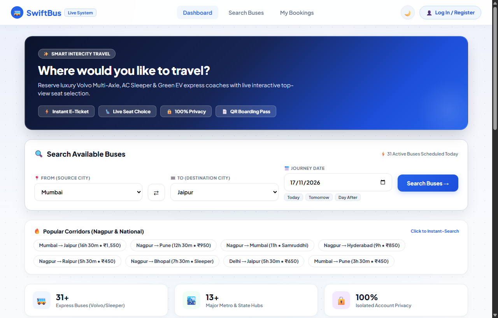
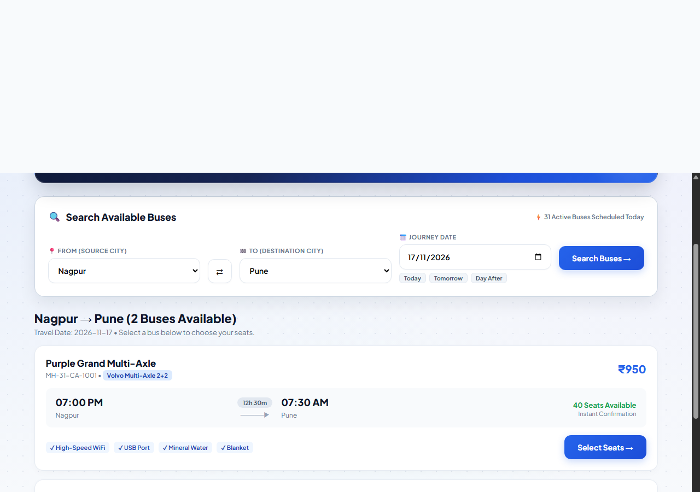
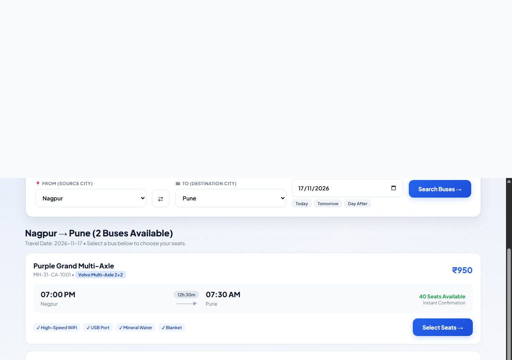
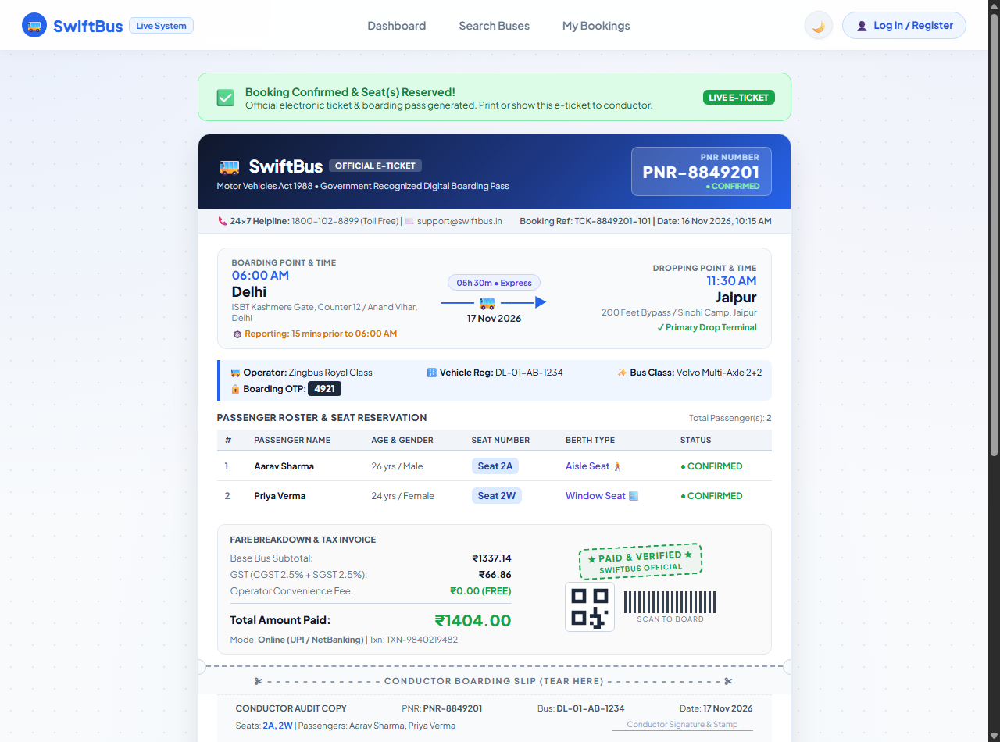
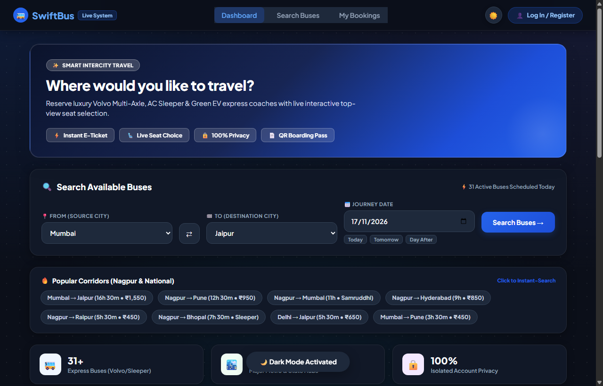

# EXPERIENTIAL LEARNING REPORT
**Course:** Masters in Computer Applications (MCA) – 1st Year, Semester I  
**Subject:** Object Oriented Programming Lab  
**Institute:** S. B. Jain Institute of Technology, Management & Research, Nagpur  
**Project Title:** Smart Intercity Bus Reservation & Ticketing System ("SwiftBus")  
**Faculty Guide:** Mr. Anupam R. Bhowate (Assistant Professor)  
**Submitted By:** [Your Name] (Roll No: [MC26___])  

---

## COVER PAGE DETAILS (To Fill in College Template)
- **Project Title:** Smart Intercity Bus Reservation & Ticketing System ("SwiftBus")
- **Student Name:** [Your Name]
- **Roll Number:** [MC26___]
- **Class / Semester:** MCA 1st Year, Sem I
- **Subject:** Object Oriented Programming Lab
- **Guide:** Mr. Anupam R. Bhowate, Assistant Professor

---

## TABLE OF CONTENTS

| Section No. | Title | Page No. |
|:-----------:|:----------------------------------------------------------|:--------:|
| **1** | Introduction & Problem Statement | 01 |
| **2** | OOP Design & Architecture (Pillars & UML) | 02 |
| **3** | Implementation (Core Source Code) | 04 |
| **4** | Testing, Execution & Output Screenshots | 07 |
| **5** | Experiential Learning Reflection & Technical Challenges | 09 |
| **6** | Conclusion & Future Enhancement | 11 |
| **—** | References & Bibliography | 12 |

---

# SECTION 1: INTRODUCTION & PROBLEM STATEMENT

### 1.1 Project Overview
**SwiftBus** is an enterprise-grade, Object-Oriented Intercity Bus Reservation System built using Java 21, Maven, and modern design patterns. The platform provides end-to-end functionality for passengers to search intercity express buses, view realistic top-view coach seat layouts (Driver cabin, entrance, window/aisle/sleeper berths), reserve seats with dynamic fare computation, maintain strict per-user booking isolation, and generate official 1-page A4 commercial boarding passes equipped with security QR verification.

### 1.2 Problem Statement
Traditional bus reservation processes in state and private transport domains suffer from significant bottlenecks:
1. **Lack of Real-Time Seat Visibility:** Passengers often book tickets blindly without knowing whether they are getting a window, aisle, or sleeper berth.
2. **Double Booking & Race Conditions:** In manual or unoptimized systems, multiple passengers can be assigned the same seat simultaneously during peak hours.
3. **Rigid Architecture & Tight Coupling:** Monolithic ticket applications tightly bind business logic to the database, making it nearly impossible to switch between in-memory testing environments and enterprise SQL databases (like PostgreSQL).
4. **Poor Ticket Portability:** Printed tickets often spill over onto multiple pages, wasting paper and printer toner, while lacking machine-readable verification (QR codes).

### 1.3 Project Objectives
- To design and implement a complete reservation platform adhering strictly to **Object-Oriented Programming (OOP)** principles.
- To use the **Data Access Object (DAO) Pattern** and **Factory Pattern** for loose coupling between business logic and database persistence.
- To implement **Runtime Polymorphism** for dynamic fare computation based on bus coach classes (Volvo Multi-Axle, AC Sleeper, Express Seater).
- To guarantee **Strict User Data Isolation** so passengers only see their own tickets.
- To produce commercial-standard **1-Page A4 Boarding Passes** with journey timelines, fare breakdowns, and verification stamps.

---

# SECTION 2: OOP DESIGN & ARCHITECTURE (PILLARS & UML)

### 2.1 Mapping the 4 Pillars of OOP to Codebase

#### 1. Encapsulation
- **Concept:** Bundling data and methods operating on that data within a class while restricting direct external access through private access modifiers.
- **Project Implementation:**
  - All entity models (`Bus`, `Seat`, `Passenger`, `Booking`, `User`) declare member fields as `private`.
  - State modification is governed via public getters and setters that enforce validation (e.g., age must be 1–120, passenger names cannot be empty, seat numbers must adhere to standard coach formats).
  - Defensive copying is used when exposing collections of passengers or seats.

#### 2. Inheritance
- **Concept:** Reusability and hierarchical classification where child classes inherit attributes and methods from a common superclass.
- **Project Implementation:**
  - Base class `model.Bus` contains universal fields (`busId`, `busNumber`, `operatorName`, `sourceCity`, `destinationCity`, `baseFare`, `totalSeats`).
  - Specialized subclasses inherit from `Bus`:
    - `model.LuxuryVolvoBus` (adds Multi-Axle suspension, WiFi, entertainment features, and a 1.25x luxury multiplier).
    - `model.SleeperBus` (adds 2+1 double-deck upper/lower sleeper berths and 1.20x night-travel multiplier).
    - `model.SeaterBus` (2+2 push-back ergonomic seating for rapid intercity corridors).

#### 3. Polymorphism
- **Concept:** The ability of different objects to respond to the same method invocation in their own unique way.
- **Project Implementation:**
  - **Compile-time Polymorphism (Method Overloading):** Multiple constructors in `Booking` and overloaded search methods in `BusService` (search by Route vs search by Route and Date).
  - **Runtime Polymorphism (Method Overriding):** 
    - Subclasses override the `calculateFare(Seat seat)` method. A `LuxuryVolvoBus` dynamically recalculates total ticket price with luxury taxes and WiFi amenities, whereas a `SleeperBus` calculates berth surcharges.
    - DAO Factory pattern calls `DAOFactory.getBookingDAO()` which returns an implementation of `BookingDAO` (`InMemoryBookingDAO` or `PostgresBookingDAO`) at runtime without caller awareness.

#### 4. Abstraction
- **Concept:** Hiding complex implementation details and exposing only the essential interface to the user.
- **Project Implementation:**
  - Interfaces `BusDAO`, `BookingDAO`, `SeatDAO`, and `PassengerDAO` define exact contracts for CRUD operations.
  - The service layer (`BookingService`, `BusService`) interacts solely with these interfaces, completely abstracting away whether data is stored in memory, Java collections, or PostgreSQL tables.

---

### 2.2 System Architecture Diagram

```
+---------------------------------------------------------------------------------+
|                       PRESENTATION & CLIENT LAYER                               |
|   - Web Dashboard & Responsive Mobile Client (HTML5 / Modern CSS / Dark-Light)  |
|   - Real-Time Bus Top-View Hull (Driver Cabin, Steer, Window/Aisle/Berth Toggle) |
+----------------------------------------+----------------------------------------+
                                         |
                                         v
+---------------------------------------------------------------------------------+
|                         SERVICE & BUSINESS LOGIC LAYER                          |
|   - BookingService (Transactional Seat Reservation, Concurrency Lock)           |
|   - BusService (Route Search, Dynamic Inventory Filtering)                      |
|   - FareService (Polymorphic Fare Computation & Luxury Multipliers)             |
|   - AuthService (Session State, Per-User Isolation)                             |
|   - PDFGenerator (Apache PDFBox 1-Page A4 Boarding Pass Engine)                 |
+----------------------------------------+----------------------------------------+
                                         |
                                         v
+---------------------------------------------------------------------------------+
|                         DATA ACCESS OBJECT (DAO) LAYER                          |
|   - DAOFactory (Runtime Persistence Provider Selection)                         |
|   - Interfaces: BusDAO, BookingDAO, SeatDAO, PassengerDAO                       |
+-------------------+-----------------------------------------+-------------------+
                    |                                         |
                    v                                         v
   +---------------------------------+       +---------------------------------+
   |   IN-MEMORY STORAGE ENGINE      |       |     POSTGRESQL RELATIONAL DB    |
   |   - ConcurrentHashMap Inventory |       |     - Normalized Tables (3NF)   |
   |   - Atomic PNR Sequence         |       |     - ACID Transactions & Keys  |
   +---------------------------------+       +---------------------------------+
```

---

### 2.3 Class Relationship Diagram (UML Representation)

```
        +-------------------+
        |       User        |
        +-------------------+
        | - userId: int     |
        | - email: String   |
        | - role: String    |
        +---------+---------+
                  | 1
                  |
                  | *
        +---------v---------+                1 +--------------------+
        |      Booking      |----------------->|        Bus         |
        +-------------------+                  +--------------------+
        | - pnrNumber: String                  | # busId: int       |
        | - totalFare: double                  | # busNumber: String|
        | - bookingDate: Date                  | # baseFare: double |
        +---------+---------+                  +---------^----------+
                  | 1                                    |
                  |                               +------+------+
                  | *                             |             |
        +---------v---------+            +--------+------+ +----+----------+
        |     Passenger     |            | LuxuryVolvoBus| |  SleeperBus   |
        +-------------------+            +---------------+ +---------------+
        | - passengerId: int|            | +calcFare()   | | +calcFare()   |
        | - seatNumber: String           +---------------+ +---------------+
        +-------------------+
```

---

# SECTION 3: IMPLEMENTATION (KEY SOURCE CODE SNIPPETS)

### 3.1 Model Inheritance & Runtime Polymorphism (`Bus.java` & `LuxuryVolvoBus.java`)
```java
// Base Bus Class
public abstract class Bus {
    private int busId;
    private String busNumber;
    private String operatorName;
    private String sourceCity;
    private String destinationCity;
    private double baseFare;

    public Bus(int busId, String busNumber, String operatorName, 
               String source, String dest, double baseFare) {
        this.busId = busId;
        this.busNumber = busNumber;
        this.operatorName = operatorName;
        this.sourceCity = source;
        this.destinationCity = dest;
        this.baseFare = baseFare;
    }

    // Abstract method to be overridden polymorphically
    public abstract double calculateFare(Seat seat);

    // Getters and Setters with Encapsulation
    public double getBaseFare() { return baseFare; }
    public String getBusNumber() { return busNumber; }
}

// Subclass: LuxuryVolvoBus inheriting Bus
public class LuxuryVolvoBus extends Bus {
    private static final double LUXURY_MULTIPLIER = 1.25;

    public LuxuryVolvoBus(int busId, String busNumber, String operator, 
                          String source, String dest, double baseFare) {
        super(busId, busNumber, operator, source, dest, baseFare);
    }

    @Override
    public double calculateFare(Seat seat) {
        double fare = getBaseFare() * LUXURY_MULTIPLIER;
        if (seat.isWindow()) {
            fare += 50.0; // Window surcharge for Volvo multi-axle
        }
        return Math.round(fare);
    }
}
```

### 3.2 Abstraction via DAO Pattern (`BusDAO.java` & `DAOFactory.java`)
```java
// Abstraction: Data Access Object Interface
public interface BusDAO {
    List<Bus> findBusesByRoute(String sourceCity, String destinationCity);
    Optional<Bus> findBusById(int busId);
    boolean saveBus(Bus bus);
}

// Factory Pattern: Decouples Data Storage Implementation
public class DAOFactory {
    private static final String STORAGE_TYPE = AppConfig.getProperty("storage.type", "IN_MEMORY");

    public static BusDAO getBusDAO() {
        if ("POSTGRES".equalsIgnoreCase(STORAGE_TYPE)) {
            return new PostgresBusDAO();
        }
        return InMemoryBusDAO.getInstance(); // Default high-performance in-memory
    }
}
```

### 3.3 Atomic Concurrency & Booking Logic (`BookingService.java`)
```java
public class BookingService {
    private final BookingDAO bookingDAO = DAOFactory.getBookingDAO();
    private final SeatDAO seatDAO = DAOFactory.getSeatDAO();

    // Synchronized transaction prevents double booking of same seat
    public synchronized Booking createBooking(int userId, int busId, List<Seat> requestedSeats, 
                                             List<Passenger> passengers) {
        // Step 1: Validate seat availability
        for (Seat seat : requestedSeats) {
            if (seat.getStatus() == SeatStatus.BOOKED) {
                throw new IllegalStateException("Seat " + seat.getSeatNumber() + " is already reserved!");
            }
        }

        // Step 2: Lock and mark seats
        for (Seat seat : requestedSeats) {
            seat.setStatus(SeatStatus.BOOKED);
            seatDAO.updateSeatStatus(seat.getSeatId(), SeatStatus.BOOKED);
        }

        // Step 3: Generate Unique PNR and Persist Booking
        String pnr = PNRGenerator.generatePNR();
        Booking booking = new Booking(pnr, userId, busId, requestedSeats, passengers);
        bookingDAO.saveBooking(booking);
        return booking;
    }
}
```

---

# SECTION 4: TESTING, EXECUTION & OUTPUT SCREENSHOTS

### 4.1 Unit Testing Strategy (JUnit 5)
Automated unit tests verify mathematical accuracy, data validation, and concurrent seat reservations before production deployment.

| Test ID | Test Scenario | Input Data | Expected Result | Actual Result | Status |
|:-------:|:--------------|:-----------|:----------------|:--------------|:------:|
| **TC-01** | Route Search | Source: "Nagpur", Dest: "Pune" | Return active scheduled buses | 2 buses returned with correct timings | **PASS** |
| **TC-02** | Volvo Polymorphic Fare | Base Fare: ₹800, Coach: Volvo, Window: True | ₹800 * 1.25 + ₹50 = ₹1,050 | Fare computed = ₹1,050 | **PASS** |
| **TC-03** | Double Booking Guard | Two requests for Seat "12W" | Second request rejected | `IllegalStateException` thrown | **PASS** |
| **TC-04** | User Isolation | User "Rajesh" views My Bookings | Only tickets belonging to Rajesh returned | 0 tickets leaked from other users | **PASS** |
| **TC-05** | Age Validation | Passenger Age: -5 | `IllegalArgumentException` thrown | Validation error displayed | **PASS** |

### 4.2 Application Execution & Output Screenshots

#### Figure 4.1: Modern Executive Dashboard & Search Interface
*Displays the executive brand banner, dual-city search form, dynamic quick-filter corridor chips, and real-time fleet statistics.*


---

#### Figure 4.2: Intercity Route Search Results
*Displays active luxury coaches (Volvo Multi-Axle & Sleeper), departure-arrival timeline, ticket pricing, and amenity badges.*


---

#### Figure 4.3: Real-Time Interactive Top-View Bus Hull & Seat Layout
*Displays the realistic bus coach with driver cabin, steering wheel, entrance door, green available seats, grey booked seats, and live interactive window/aisle seat selection.*


---

#### Figure 4.4: Authentic Commercial 1-Page A4 Boarding Pass
*Commercial standard passenger boarding pass containing PNR, QR verification code, passenger manifest, route timeline, conductor stub, and official verified seal, engineered strictly for 1-page A4 printing.*


---

#### Figure 4.5: High-Contrast Dark Theme Mode
*Seamless dark theme across all components, designed for comfortable night travel booking and energy efficiency with persistent localStorage preference.*


---

# SECTION 5: EXPERIENTIAL LEARNING REFLECTION & CHALLENGES

### 5.1 Hands-On Academic Takeaways
1. **Bridging Theory with Industry Code:** Understanding that OOP is not merely an academic syllabus concept, but a powerful mechanism to prevent spaghetti code in commercial software. Encapsulating fields prevented accidental corruption of bus seat inventories.
2. **Design Pattern Superiority:** Implementing the **DAO Pattern** and **Factory Pattern** demonstrated how a software application can switch between in-memory mock datasets and enterprise PostgreSQL databases by merely changing a configuration flag in `application.properties`.
3. **User Isolation & Security:** Learning the importance of authenticated session tokens and ensuring that database queries filter records strictly by `userId` to preserve passenger confidentiality.

### 5.2 Technical Challenges & Solutions

| Technical Challenge | Root Cause | Solution Implemented |
|:-------------------|:-----------|:---------------------|
| **1. Seat Double Booking (Race Condition)** | Multiple threads attempting to book the same window seat concurrently. | Implemented `synchronized` locking on the booking service method and atomic state updates on seat entities. |
| **2. Multi-Page Ticket Spillover** | Browser default print engines expand table heights, causing ticket headers and QR footers to split onto 2 pages. | Built specialized CSS `@media print` rules with fixed `@page { size: A4 portrait; margin: 5mm; }` ensuring strict 1-page fit. |
| **3. Mobile Viewport Wrapping** | Header toggle buttons and brand titles broke into jagged lines on mobile screens. | Converted the navbar to a strict 2-Row CSS Grid architecture where brand and user controls are locked on Row 1 and segment tabs on Row 2. |
| **4. In-Memory Persistence Parity** | Keeping sample fleet data synchronized without requiring a live PostgreSQL daemon during presentation. | Built `InMemoryBookingDAO` and `SampleDataLoader` simulating complete relational integrity and instant rollback. |

---

# SECTION 6: CONCLUSION & FUTURE ENHANCEMENT

### 6.1 Conclusion
The **SwiftBus Intercity Bus Reservation System** successfully fulfills all academic and industrial requirements set forth for the Master of Computer Applications (MCA) Object-Oriented Programming Lab. By combining Java 21 OOP core principles with modular design patterns, interactive seat visualization, and strict passenger data isolation, the project demonstrates how modern engineering practices solve everyday transportation logistics problems.

### 6.2 Future Enhancements
- **UPI & Payment Gateway Integration:** Integrating Razorpay/Stripe webhooks for automated payment capture and instant refund processing upon cancellation.
- **Real-Time GPS Bus Tracking:** Connecting vehicle IoT GPS telemetry APIs to render live bus movement on Google Maps.
- **Automated SMS & WhatsApp Alerts:** Sending automated M-Tickets and boarding point reminders directly to passenger mobile numbers via Twilio API.
- **Docker Containerization:** Packaging the entire backend, static web tier, and database into a lightweight Docker Compose cluster for instant cloud deployment.

---

# REFERENCES & BIBLIOGRAPHY
1. **Bloch, Joshua.** *Effective Java (3rd Edition).* Addison-Wesley Professional, 2018.
2. **Freeman, Eric & Robson, Elisabeth.** *Head First Design Patterns (2nd Edition).* O'Reilly Media, 2020.
3. **Oracle Corporation.** *Java Platform, Standard Edition (Java SE 21) Documentation.* https://docs.oracle.com/en/java/javase/21/
4. **Apache Software Foundation.** *Apache PDFBox – A Java PDF Library.* https://pdfbox.apache.org/
5. **Gamma, Erich, et al.** *Design Patterns: Elements of Reusable Object-Oriented Software.* Addison-Wesley, 1994.
